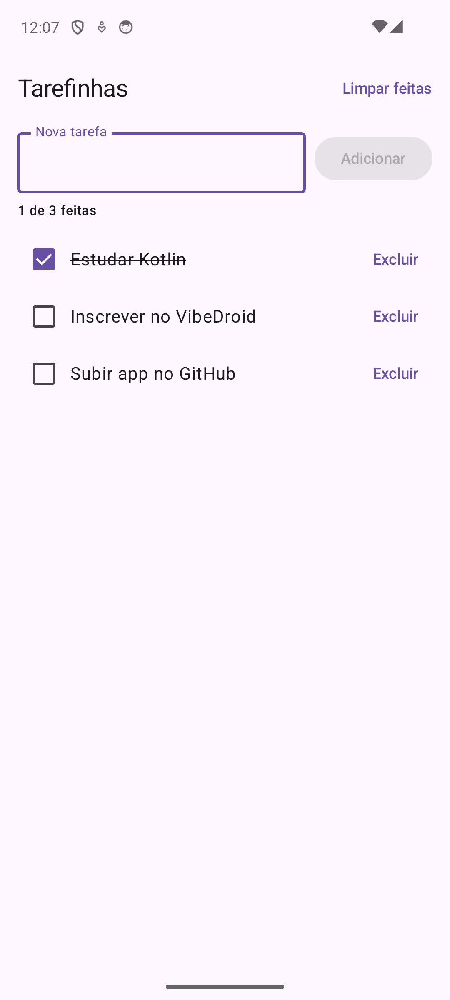

# Tarefinhas

App Android de lista de tarefas, feito em **Kotlin** com **Jetpack Compose**.



## O que faz

- Adiciona tarefas (botão ou tecla "concluído" do teclado)
- Marca e desmarca como feita
- Exclui uma tarefa ou limpa todas as feitas
- Mostra o progresso ("1 de 3 feitas")
- Salva tudo no aparelho: as tarefas continuam lá ao fechar o app
- Tema claro e escuro, seguindo o sistema

## Como é feito

| Arquivo | Papel |
|---|---|
| `Tarefa.kt` | Modelo e regras da lista (adicionar, alternar, remover, salvar em texto), em funções puras |
| `TarefasViewModel.kt` | Guarda o estado em `StateFlow` e persiste em `SharedPreferences` |
| `MainActivity.kt` | Interface em Compose (Material 3) |
| `TarefaTest.kt` | Testes unitários das regras com JUnit |

- Kotlin 2.2, Compose BOM, Material 3, ViewModel
- minSdk 24, targetSdk 36

## Rodar

```bash
./gradlew testDebugUnitTest   # testes
./gradlew assembleDebug       # APK em app/build/outputs/apk/debug/
```

Ou abra a pasta no Android Studio e clique em Run.
